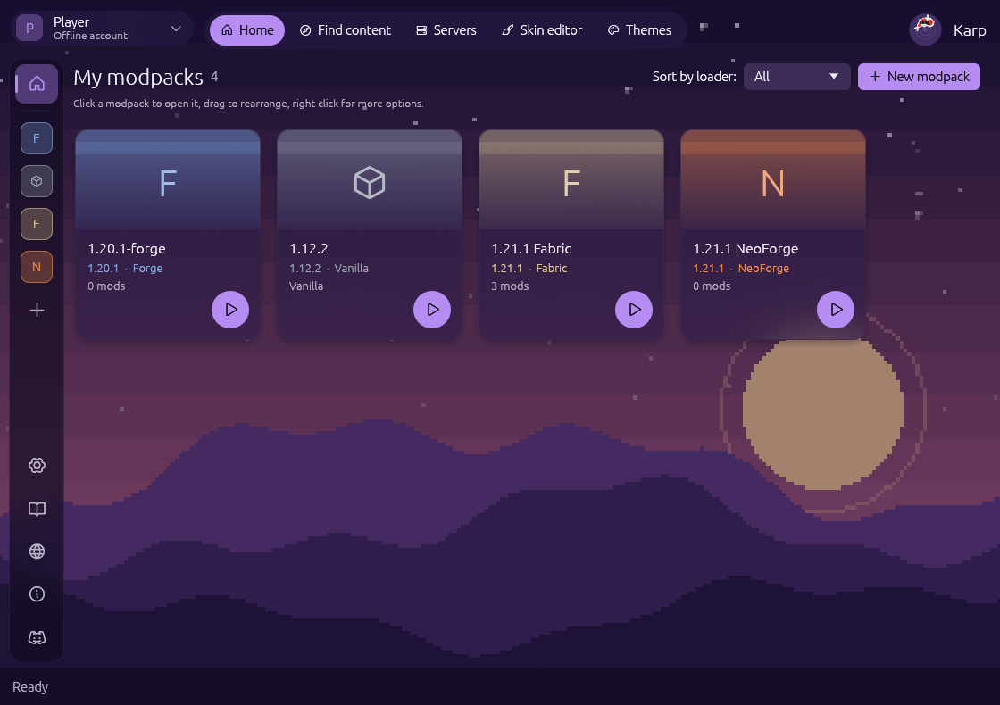
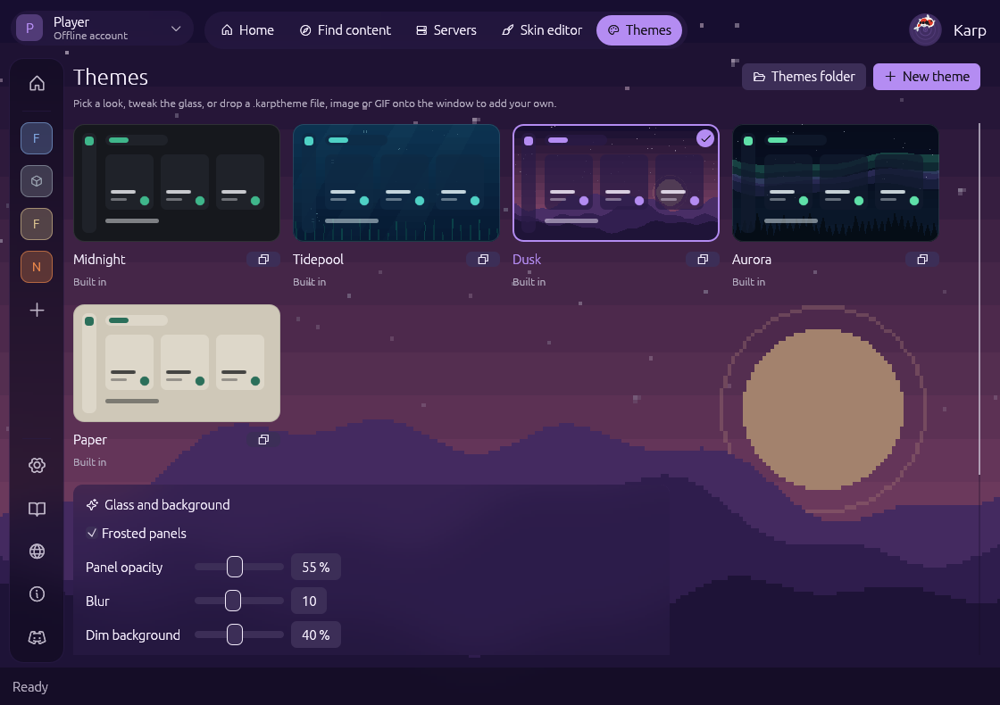

# Karp Launcher

A fast, tidy Minecraft launcher and mod manager, built in Rust.

**Status:** early development. The launcher already installs and plays modded Minecraft; the code will be published here once the core is stable.

## Why

Existing mod platforms and launchers are slow and cluttered. This project aims to be the opposite: one clean app that installs, updates and launches modded Minecraft without getting in your way.

## What it does today

- **Loaders:** Vanilla (old and new versions), Fabric, NeoForge and Forge
- **No Java setup:** the correct Java runtime is downloaded automatically
- **Modpacks:** separate modpacks, each with its own version, loader, content and settings; rename, clone, reorder, delete, desktop shortcuts
- **Find content:** search Modrinth for mods, modpacks, resource packs and shaders, filtered to what fits the chosen modpack, with full project pages in the app
- **Dependencies and updates:** required mods are installed automatically; check for updates and update everything at once
- **Switch mods off** without removing them, for tracking down crashes
- **Import and export** modpacks as standard `.mrpack` files
- **Shared game settings:** set FOV, auto-jump, key binds and more once, and every modpack starts with them
- **Themes:** built-in looks with animated backgrounds and frosted panels, plus your own themes, shareable as `.karptheme` files
- **Fast:** parallel, checksum-verified downloads; nothing already on disk is downloaded again

## Progress

- [x] Install and launch vanilla Minecraft (old and new versions)
- [x] Automatic Java runtime download
- [x] Fabric
- [x] NeoForge and Forge
- [x] Search and install from Modrinth (mods, modpacks, resource packs, shaders)
- [x] Desktop app
- [x] Themes
- [ ] Microsoft account sign-in, using the official Microsoft/Xbox flow (waiting on approval; offline accounts for now)
- [ ] CurseForge (API access applied for)
- [ ] Horizon
- [ ] Servers page and skin editor
- [ ] Installer and automatic updates

## Mod authors

Karp only downloads projects whose authors allow third-party downloads, and never re-hosts files. Every project shows its author and links back to its page on the platform it came from.

## Notes

This is an independent hobby project. It is not an official Minecraft product and is not approved by or associated with Mojang or Microsoft. Minecraft game files are downloaded directly from Mojang's servers when you play and are never included in this repository.
