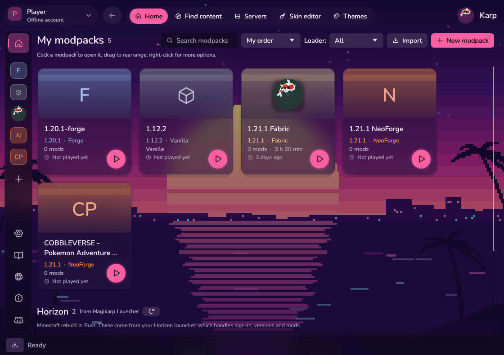
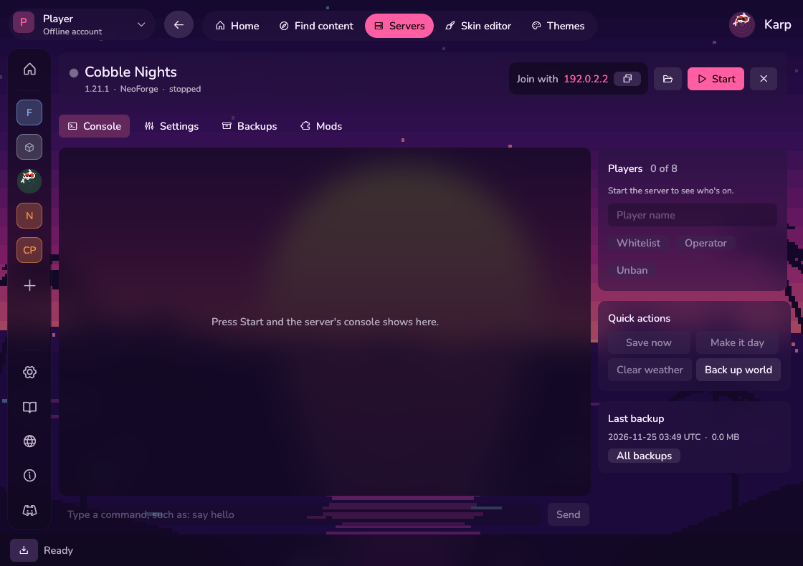
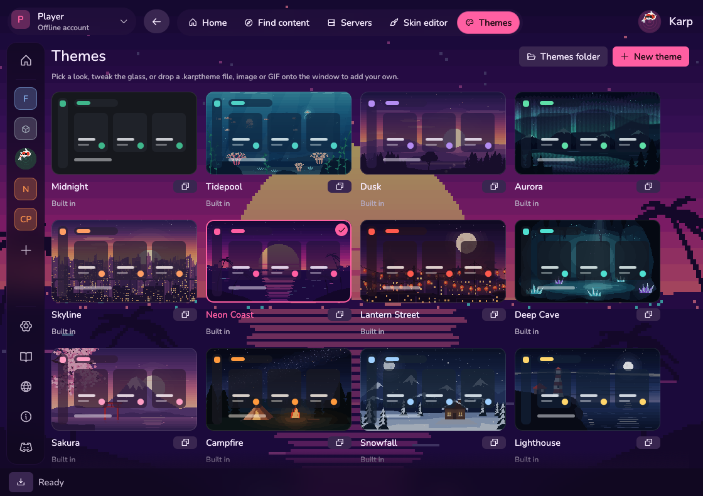

# Karp Launcher

A fast, tidy Minecraft launcher and mod manager, built in Rust.

**Status:** in testing. Test builds for Windows are going out to a small group of testers; the code will be published here once the core is stable. Found a problem in a test build? Please [open an issue](../../issues).

## Why

Existing mod platforms and launchers are slow and cluttered. This project aims to be the opposite: one clean app that installs, updates and launches modded Minecraft without getting in your way.

## What it does today

**Playing**
- **Loaders:** Vanilla (old and new versions), Fabric, Quilt, NeoForge and Forge
- **No Java setup:** the correct Java runtime is downloaded automatically
- **Microsoft sign-in** through the official Microsoft/Xbox flow, or offline names for single player
- **Horizon:** modpacks from an installed Horizon launcher show up and start from Karp

**Modpacks**
- Separate modpacks, each with its own version, loader, content, memory and settings; pin, reorder, rename, clone, desktop shortcuts
- **Find content:** search Modrinth for mods, modpacks, resource packs and shaders, filtered to what fits the chosen modpack, with full project pages and galleries in the app, and a download queue
- **Dependencies and updates:** required mods are installed automatically; update mods one by one, or follow a Modrinth modpack's own versions and move between them
- **Mod check before playing:** catches missing, doubled, wrong-loader and clashing mods, with one-click fixes
- **Crash helper:** reads a crash and says in plain words what most likely went wrong
- **Share a modpack with a code** a friend pastes in, or export a standard `.mrpack` file
- **Import** modpacks from CurseForge, Prism and the Modrinth app
- **Worlds:** back up, restore and delete; a screenshots tab per modpack

**Servers**
- Host a server for friends from the app: Vanilla, Fabric, Quilt, NeoForge or Forge, made from scratch, from one of your modpacks, or straight from a Modrinth modpack
- Console, who's online, one-click operator / whitelist / kick, and world backups on a timer or when the server stops

**Looks and extras**
- **Themes:** fourteen built-in looks with animated backgrounds and frosted panels, plus your own, shareable as `.karptheme` files
- **Skin editor:** 3D preview, capes, skins from a file, a player name or a link, and a pixel painter
- **Discord status**, disk usage, shared game settings (FOV, key binds and more, set once for every modpack)
- **Fast:** parallel, checksum-verified downloads; nothing already on disk is downloaded again

## Progress

- [x] Install and launch vanilla Minecraft (old and new versions)
- [x] Automatic Java runtime download
- [x] Fabric, Quilt, NeoForge and Forge
- [x] Search and install from Modrinth (mods, modpacks, resource packs, shaders)
- [x] Desktop app and themes
- [x] Microsoft account sign-in
- [x] Servers page and skin editor
- [x] Horizon modpacks through an installed Horizon launcher
- [x] First test builds for Windows
- [ ] CurseForge (API access applied for)
- [ ] Horizon without needing its launcher installed
- [ ] Installer and automatic updates
- [ ] Publish the source code

## Mod authors

Karp only downloads projects whose authors allow third-party downloads, and never re-hosts files. Every project shows its author and links back to its page on the platform it came from.

## Notes

This is an independent hobby project. It is not an official Minecraft product and is not approved by or associated with Mojang or Microsoft. Minecraft game files are downloaded directly from Mojang's servers when you play and are never included in this repository.
